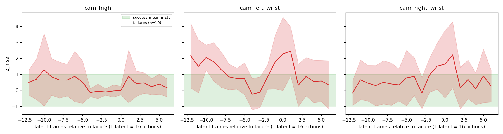
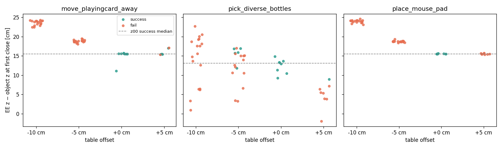
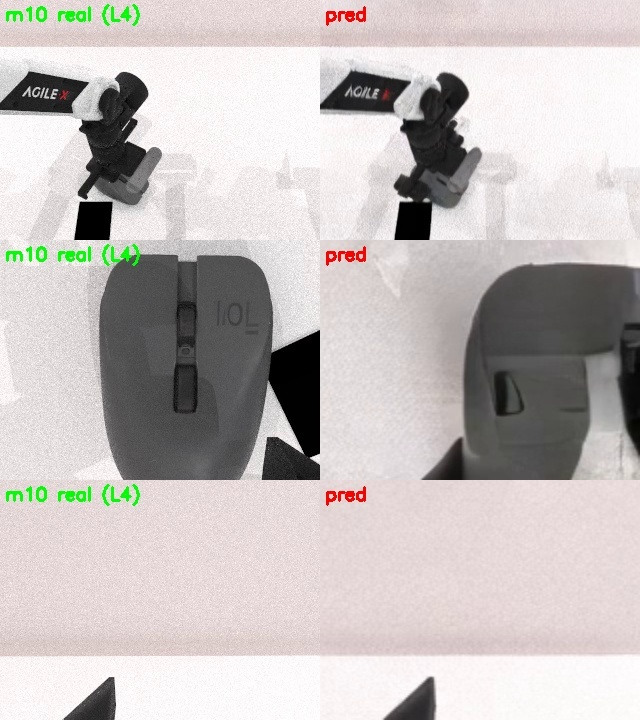
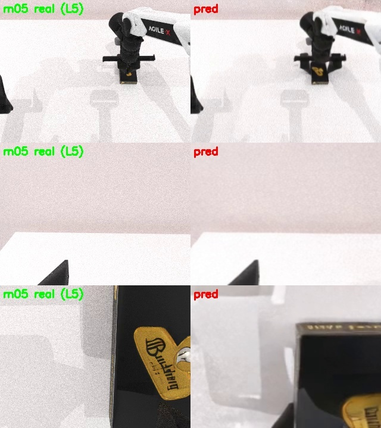
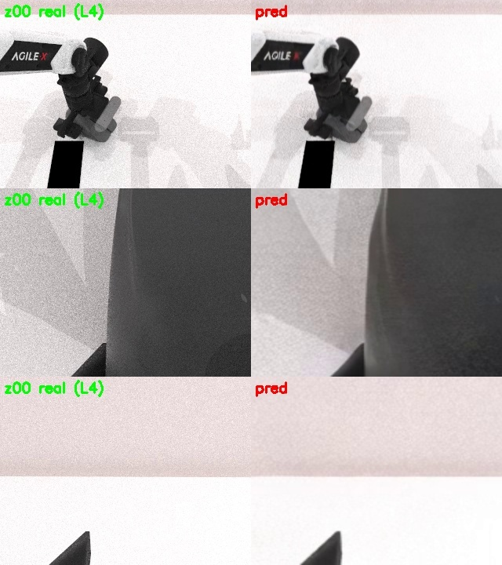

# Fehleranalyse LingBot-VA auf RoboTwin 2.0 – Befunde

Stand: 2026-11-03. Datengrundlage: alle bisher aufgezeichneten Läufe in `results/`. Neu gegenüber dem Projekt-Hub
ist Abschnitt 5 (vorgestellte vs. reale Zukunft). Er ändert, welche Methoden sinnvoll sind (Abschnitt 7).

## Kurzfassung

1. **LingBot-VA scheitert reproduzierbar und an denselben Stellen.** Im Hard-Setting sind 10 von 100 Episoden gescheitert.
   Die Fehlerzeitpunkte liegen pro Aufgabe innerhalb von ±3 Env-Steps.
2. **Fehler lassen sich aus der eigenen Vorhersage erkennen.** Die Kosinus-Distanz zwischen vorhergesagtem und echtem
   Latent der Handgelenkkameras erreicht eine faire AUC von 0,84–0,88 (nur Latents bis Fehler + 1). Sie steigt etwa
   3 Latents (≈ 48 Env-Steps) vor dem Fehler. Die Kopfkamera und die Hidden States taugen dafür kaum.
3. **Bei einer geometrischen Verschiebung bricht das Modell zusammen.** Wird der Tisch um 5 cm gesenkt, fällt die
   Erfolgsrate von 24/24 auf 6/54, bei 10 cm auf 0/54. Die kommandierte Greifhöhe geht nur 2–4 cm mit.
4. **Neu: Das Video-Modell stellt sich den Erfolg vor, die Aktionen setzen ihn nicht um.** Am Greifzeitpunkt zeigt die
   *vorhergesagte* Handgelenkkamera das Objekt zwischen den Fingern. Real schließt der Greifer darüber. Die Distanz
   zwischen Vorhersage und Realität am Greif-Latent wächst mit der Verschiebung: 0,21 bei 0 cm, 0,35 bei −5 cm,
   0,39 bei −10 cm. Erfolgreiche Episoden liegen bei jeder Höhe um 0,21–0,24.
5. **Die Aktions-Tokens schauen zu 50–59 % auf vergangene Aktionen und nur zu 6–8 % auf jede Handgelenkkamera.**
   Zusammen mit Punkt 4 heißt das: Die Fehler entstehen an der **Kopplung von Video und Aktion**. Der Aktionspfad folgt
   seinem Prior aus der Aktionshistorie statt der vorgestellten Zukunft. Der Videopfad allein ist nicht die Ursache.

Daraus folgt der Kern des Experimentplans: Methoden, die die vorgestellte Zukunft stärker in die Aktion bringen,
also Imagination Guidance, ein Adapter auf dem Aktionspfad und Best-of-N mit Konsistenzprüfung. Dazu kommen Methoden,
die die Diskrepanz online erkennen und korrigieren: Kontext-Reset, Sprach- bzw. Negativ-Prompt und Re-Grasp.
Methoden, die nur die Video-Vorhersage „genauer“ machen, sind für die Tischhöhe zweitrangig.

---

## 1. Datengrundlage

| Lauf | Setting | Aufgaben | Episoden | Erfolg |
|---|---|---|---|---|
| `results/eval_hard` | `demo_randomized` (Hard) | handover_block, pick_diverse_bottles | 100 | 90 |
| `results/table_height` | `table_h_{p05,z00,m05,m10}` (8 Ep. je Zelle) | move_playingcard_away, place_mouse_pad, pick_diverse_bottles | 96 | 38 |
| `results/table_height_n10` | `table_h_{m05,m10}` (10 Ep. je Zelle) | wie oben | 60 | 1 |

Pro Episode liegt ein `episode.h5` mit allem Nötigen vor: vorhergesagte und beobachtete Latents pro Kamera,
Zwischenstände des Denoisings, Hidden States (Layer 9/19/29), Noise-Seeds, geplante und ausgeführte Aktionen,
Simulationszustand mit Kontakten. Dazu kommen die Videos `real_*.mp4` und `pred_*.mp4`.
Das ist schon ein vollständiger Trainingsdatensatz im Latent-Raum des Modells (siehe `docs/EXPERIMENTS.md`, Abschnitt D).

## 2. Fehlertypen im Hard-Setting

- **handover_block** (4/50 Fails): immer `dropped` bei der Übergabe, Env-Step 191–196, Latent 12–13.
- **pick_diverse_bottles** (6/50 Fails): immer `missed_grasp` beim ersten Griff, Env-Step 59–62, Latent 4.
  Eine Ausnahme liegt bei Step 274.
- Pro Aufgabe gibt es genau einen Fehlertyp, und er tritt immer in derselben Phase auf. Das spricht für
  systematische Schwächen in einer Teilaufgabe und nicht für zufälliges Rauschen.

## 3. Fehlererkennung aus dem Vorhersagefehler

Gemessen wird der Mismatch zwischen dem vorhergesagten Latent eines Chunks und dem danach beobachteten Latent,
z-standardisiert mit den Erfolgen derselben Aufgabe und Kamera.

| Metrik | Kamera | AUC ganze Episode | AUC bis Fehler + 1 (fair) |
|---|---|---|---|
| cos | rechtes Handgelenk | 0,95 | **0,88** |
| cos | linkes Handgelenk | 0,98 | **0,84** |
| z_mse | linkes Handgelenk | 0,97 | 0,82 |
| hid_cos L9 | linkes Handgelenk | 0,98 | 0,74 |
| hid_cos L19 | linkes Handgelenk | 0,95 | 0,70 |
| z_mse | Kopf | 0,47 | 0,32 |

- Die Episodenmaxima sind längenverzerrt: Fails laufen bis zum Step-Limit, Erfolge enden früh. Belastbar ist nur die
  rechte Spalte.
- Der Anstieg beginnt etwa 3 Latents vor dem Fehler. Ein Online-Detektor hätte also 1–2 Chunks Vorlauf.
  Das ist die Grundlage für alle Eingriffe, die erst bei einem Fehlerverdacht greifen (Experimente B3, B4, C2).
- Die Kopfkamera trägt kein Signal. Sie hat zwar die meisten Tokens (8 × 10), aber der Greifkontakt ist dort zu klein.
- 

## 4. Tischhöhe: eine reine Geometrie-Verschiebung

Tisch und Objekte werden gemeinsam verschoben, Roboter und Kameras bleiben fix (`table_height_bias`).

| Aufgabe | −10 cm | −5 cm | 0 cm | +5 cm |
|---|---|---|---|---|
| move_playingcard_away | 0/18 | 1/18 | 8/8 | 6/8 |
| place_mouse_pad | 0/18 | 0/18 | 8/8 | 0/8 |
| pick_diverse_bottles | 0/18 | 5/18 | 8/8 | 1/8 |

Mediane aus `results/table_height_analysis/episodes.csv`:

| Aufgabe | Offset | Objekt-z | tiefste EE-z | Greifer über Objekt beim Schließen (dz) | Kontakt |
|---|---|---|---|---|---|
| move_playingcard_away | −10 / −5 / 0 / +5 cm | 0,641 / 0,691 / 0,741 / 0,791 | 0,865 / 0,868 / 0,896 / 0,940 | 0,239 / 0,188 / 0,155 / 0,155 | 0 / 0 / 1 / 1 |
| place_mouse_pad | dito | 0,641 / 0,691 / 0,741 / 0,791 | 0,865 / 0,865 / 0,896 / 0,940 | 0,240 / 0,187 / 0,155 / 0,155 | 0 / 0 / 1 / 1 |
| pick_diverse_bottles | dito | 0,640 / 0,690 / 0,740 / 0,790 | 0,815 / 0,819 / 0,865 / 0,835 | 0,165 / 0,145 / 0,131 / 0,054 | 0 / 1 / 1 / 0,5 |

- Der Tisch sinkt um 5 bzw. 10 cm, die tiefste EE-Höhe aber nur um 3 cm. Zwischen −5 und −10 cm ändert sie sich
  gar nicht mehr.
- Kommandierte und erreichte Höhe sind gleich. Ein Reichweitenlimit ist es also nicht, sondern die Policy selbst.
- Bei +5 cm wird dieselbe Höhe kommandiert wie bei 0 cm. Der Tisch stoppt den Greifer physisch.
- Reproduzierbarkeit: 43 von 46 doppelt gefahrenen (Task, Offset, Seed)-Kombinationen hatten dasselbe Ergebnis.
  Unterschiede von 1–3 Erfolgen pro Zelle sind bei 8–18 Episoden nicht belastbar.
- Trainingsverteilung: `demo_randomized` variiert die Tischhöhe nur um 0 bis −3 cm (`random_table_height: 0.03`).
  −5 und −10 cm liegen also klar außerhalb der Verteilung.

## 5. Neu: vorgestellte vs. reale Zukunft am Greifzeitpunkt

Für jede Tischhöhen-Episode wird das erste Schließen des Greifers bestimmt. Am zugehörigen Latent werden dann
vorhergesagtes und beobachtetes Latent der greifenden Handgelenkkamera verglichen (Kosinus-Distanz).
Reproduzierbar mit `python -m fawam.analysis_gap gap results/table_height results/table_height_n10`.

| Offset | Erfolg | Kosinus-Distanz am Greif-Latent (Mittel ± Std) | n |
|---|---|---|---|
| 0 cm | ja | 0,210 ± 0,079 | 24 |
| −5 cm | ja | 0,214 ± 0,073 | 6 |
| −5 cm | nein | 0,346 ± 0,129 | 48 |
| −10 cm | nein | 0,392 ± 0,132 | 54 |
| +5 cm | ja | 0,239 ± 0,040 | 5 |
| +5 cm | nein | 0,335 ± 0,199 | 17 |

Dekodierte Bilder zeigen, woher die Lücke kommt (links real, rechts vorhergesagt; Kopf, linkes, rechtes Handgelenk):

- **−10 cm, place_mouse_pad:** Real sieht die linke Handgelenkkamera die ganze Maus von oben, der Greifer ist also
  zu hoch. Vorhergesagt ist die Maus direkt zwischen den Fingern.
  
- **−5 cm, move_playingcard_away:** Auf der Kopfkamera umschließen die Finger in der Vorhersage die Box.
  Real stehen sie darüber.
  
- **0 cm (Referenz):** Vorhersage und Realität stimmen überein.
  

**Interpretation.** Der Videopfad sieht im ersten Bild, dass der Tisch tiefer steht, und „plant“ einen korrekten Griff.
Der Aktionspfad erzeugt danach Aktionen, die diesen Plan nicht umsetzen. Das passt zur Attention-Analyse:
Die 32 Aktions-Tokens eines Chunks legen im Mittel 50–59 % ihrer Attention auf vergangene Aktionen.
Auf die Kopfkamera fallen 29–35 %, auf jede Handgelenkkamera nur 6–8 %.

| Episodenphase | vergangene Aktionen | Kopf | linkes Handgelenk | rechtes Handgelenk |
|---|---|---|---|---|
| erstes Drittel | 0,587 | 0,285 | 0,066 | 0,063 |
| mittleres Drittel | 0,522 | 0,341 | 0,061 | 0,076 |
| letztes Drittel | 0,501 | 0,354 | 0,070 | 0,075 |

Wir nennen das die **Imagination-Execution-Lücke**: Die Vorhersage ist (näherungsweise) richtig, die Ausführung nicht.
Das ist ein anderer Fehler als im Dual-Site-Adapter-Paper. Dort war das Vorhersagemodell selbst falsch, weil sich die
Dynamik geändert hatte, und ein fester CEM-Planer hing davon ab.

Vorbehalte:
- Die visuelle Aussage stützt sich auf zwei angesehene Episoden. Die Zahlen oben decken alle 154 ab.
- Ein Teil der Distanz kommt einfach daher, dass sich die Realität nach einer falschen Aktion vom Plan entfernt.
  Die Distanz misst also Lücke **und** Folgefehler. Erfolge bei −5 cm liegen aber auf dem Niveau von 0 cm. Das spricht
  dafür, dass die Distanz die Ausführungslücke anzeigt und nicht die Verschiebung an sich.
- Ob der Videopfad bei −10 cm auch die *Tiefe* richtig vorstellt oder nur „irgendeinen Griff“, ist offen.
  Das prüft Experiment A0: Greiferhöhe aus der vorhergesagten Handgelenkkamera schätzen, mit einem Probe auf
  Latents mit Sim-Labels.

## 6. Attention

- Kopfkamera: Aufmerksamkeit auf den eigenen Greifer und das Zielobjekt. Handgelenkkameras: auf die Fingerspitzen
  unten in den Bildecken.
- Der Anteil pro Kamera unterscheidet sich nicht zwischen Fails und Erfolgen. Er hängt nur von der Episodenzeit ab:
  Die Kopfkamera steigt von 25 % auf 37 %, die vergangenen Aktionen fallen von 65 % auf 47 %.
- Bei Fails wird die räumliche Attention diffus, zum Beispiel in handover ep0002 ab Chunk 4. Bei missed_grasp bleibt
  sie auf dem Greifer fixiert, auch während die Flasche schon kippt.
- Die Handgelenkkameras haben nur 4 × 5 Tokens (64 px pro Token). Feine Höhenunterschiede kann das Modell dort kaum
  auflösen. Das ist ein Grund mehr, die vorgestellte Zukunft explizit in die Aktion zu zwingen, statt auf mehr
  Bildauflösung zu hoffen.

## 7. Was das für die Methoden heißt

| Hypothese | Prüfbar mit | Erwartung, wenn sie stimmt |
|---|---|---|
| H1: Der Aktionspfad unterschätzt die vorgestellten Frames. | A1 Imagination Guidance (CFG über die Pred-Frames im KV-Cache) | Tiefere Greifhöhe bei −5/−10 cm, Erfolgsrate steigt ohne Training. |
| H2: Der Aktions-Prior aus der Historie dominiert. | A2 Attention-Reweighting bzw. History-Dropout bei der Inferenz | Wie H1. Bei 0 cm darf es nicht schlechter werden. |
| H3: Wenige Demos unter der Verschiebung reichen, um den Aktionspfad zu kalibrieren. | D1/D2 Dual-Site-Adapter mit Expert-Replays | Mit 3–10 Demos deutlich besser als ohne. Beim Nominal-Setting leichter Verlust (wie im Paper: 85 → 54 %). |
| H4: Die Lücke ist online erkennbar, bevor der Griff scheitert. | B1 Detektor auf pred-vs-obs pro Chunk | AUC > 0,8 einen Chunk vor dem Schließen. |
| H5: Ein Neuplanen nach erkannter Lücke rettet Episoden. | B3 Kontext-Reset, B4 Re-Prompt, C2 VLM-Analyse | Ein Teil der missed_grasp wird zu Erfolgen (Re-Grasp). |
| H6: Mehr Proben der Vorstellung plus Konsistenz-Score helfen. | A3 Best-of-N | Kleiner Gewinn im Hard-Setting, kaum Gewinn bei der Tischhöhe, falls H1 stimmt. |

Der rein selbstüberwachte Adapter auf **eigenen Fail-Rollouts** ist eine direkte Übertragung des Papers. Er lernt
die Dynamik „Greifer schließt über dem Objekt“ und würde den Videopfad eher auf Misserfolg trainieren. Sinnvoll ist er
nur in zwei Formen. Erstens für den **Aktionspfad mit Hindsight-Relabeling**: Die ausgeführten Aktionen haben genau
das beobachtete Video erzeugt, als Inverse-Dynamik-Paar ist das also immer korrekt. Zweitens zusammen mit einem
**Planer** (Best-of-N bzw. CEM über Aktions-Chunks), der das adaptierte Vorwärtsmodell nutzt. Das ist die
paper-treue Variante D3.

## 8. Offene Lücken in der Analyse

- Eine Video-Probe für die vorgestellte Greiferhöhe fehlt noch (A0). Ohne sie bleibt H1 eine Interpretation.
- Bei der Tischhöhe sind nur 3 Aufgaben untersucht und nur Greifaufgaben. handover und Platzieren fehlen.
- Hard-Setting: Für eine belastbare Fehlerstatistik reichen 10 Fails nicht. Auf dem Cluster sollten es 200–500
  Episoden pro Aufgabe sein, verteilt auf mehr Aufgaben (Plan in `docs/EXPERIMENTS.md`, Abschnitt F).
- Die anderen Benchmarks (RoboDojo, RoboLab, MolmoSpaces-CS) sind nicht angefasst. Das ist erst nach den
  RoboTwin-Ergebnissen sinnvoll.
